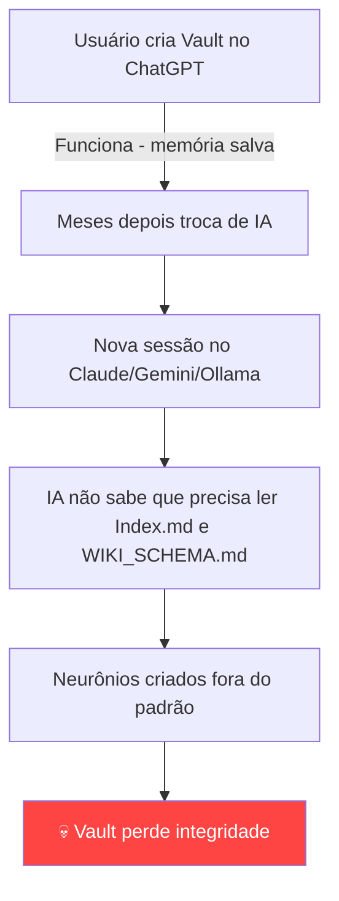

# Persistencia_de_Contexto — Por que a IA não é a Memória

## 💡 Conceito
Este neurônio documenta o risco arquitetural de depender da "Memória Global" de uma LLM para manter a integridade do Cofre de Neurônios, e a solução adotada: tratar o **Vault em disco como a única fonte de verdade**, tornando o sistema agnóstico de modelo.

---

## 🛠️ Aplicação Técnica

### O Problema Original

A versão inicial do `[[Wiki_Bootstrap_Protocol]]` continha esta diretiva:

> *"Salve em sua Memória Global a seguinte diretiva: Sempre que iniciar este workspace, você DEVE ler os arquivos Index.md e WIKI_SCHEMA.md..."*

A intenção era fazer a IA **lembrar** automaticamente de carregar o contexto. Porém, isso cria uma **dependência proprietária** — só funciona em IAs que possuem memória persistente entre sessões.

### Nem toda IA tem "memória" entre conversas

| IA | Memória persistente? | Como funciona |
|---|---|---|
| **ChatGPT (Plus)** | ✅ Sim | Possui "Memory" — salva instruções entre chats |
| **Claude** | ❌ Não | Cada conversa começa do zero |
| **Gemini** | ⚠️ Parcial | Possui "Gems" mas não é memória automática |
| **Antigravity** | ⚠️ Parcial | Knowledge Items por workspace, não universais |
| **LLMs locais (Ollama, LM Studio)** | ❌ Não | Sem memória nenhuma |

> [!caution] Se a IA não tiver memória persistente, a diretiva "Salve em sua Memória Global" é simplesmente **ignorada**. O Vault perde a governança silenciosamente.

### O Risco na Prática



### A Correção Aplicada

| Antes — Frágil | Depois — Robusto |
|---|---|
| *"IA, lembre-se disso"* | *"Humano, alimente a IA com isso"* |
| Depende da IA ter memória | Depende só de copiar/colar 2 arquivos |
| Funciona apenas no ChatGPT | Funciona com **qualquer** IA |
| A IA pode "esquecer" | Impossível esquecer — o arquivo existe no disco |

A nova diretiva no `[[Wiki_Bootstrap_Protocol]]` (v2) diz:

> *"Ao iniciar qualquer sessão de trabalho no Vault, a LLM **deve receber como contexto** o conteúdo de `/30_Atlas/Index.md` e `/50_System/WIKI_SCHEMA.md`."*

A responsabilidade sai da IA e vai para o **fluxo de trabalho do usuário**.

### Como usar na prática

Ao iniciar uma nova sessão com **qualquer** IA, basta enviar:

```
Aqui está o meu Vault de conhecimento. Antes de agir, leia estas regras:

[cola o conteúdo do WIKI_SCHEMA.md]

E aqui está o mapa atual do conhecimento:

[cola o conteúdo do Index.md]

Agora me ajude a [sua tarefa aqui].
```

### Princípio Fundamental

> [!important] **O Obsidian é a memória. O arquivo em disco é a memória. Não a IA.**
> Isso torna o sistema à prova de futuro — se amanhã surgir uma IA nova, você não perde nada. A inteligência está na **estrutura dos arquivos**, não no modelo que os manipula.

---

## 🔗 Conexões
- MOC: [[Index]] (Governança)
- Relacionados: [[Wiki_Bootstrap_Protocol]], [[WIKI_SCHEMA]], [[Parecer_Arquitetura_Cofre]]
